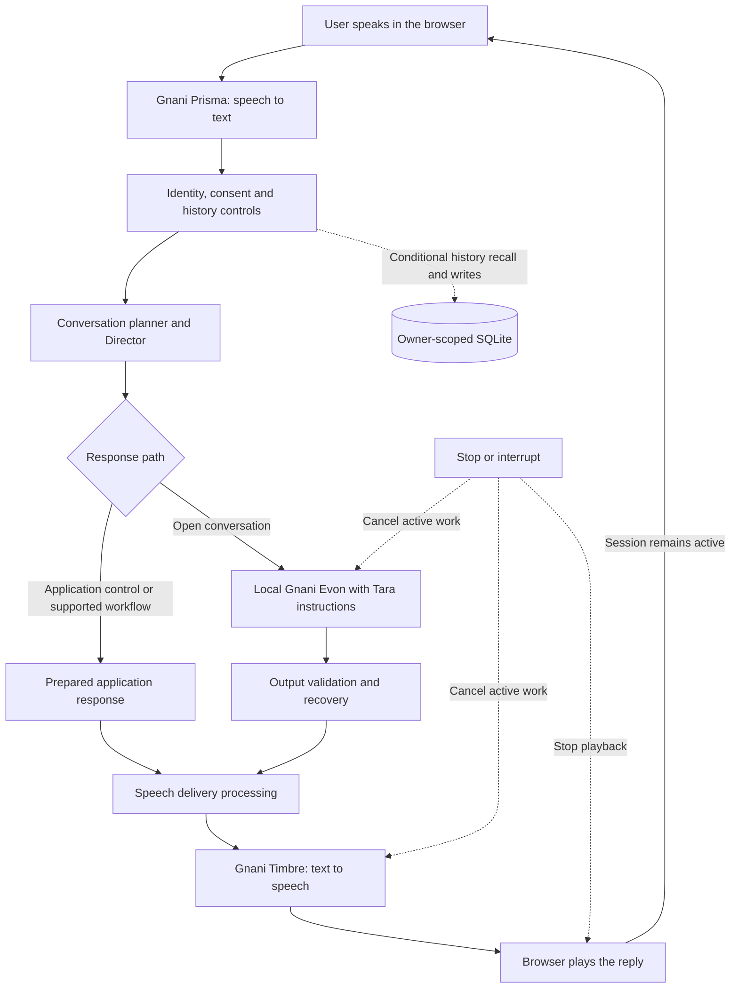

# Dost

**A Hindi/Hinglish voice companion designed for patient, everyday conversation with older adults.** Dost brings speech recognition, a local language model and speech synthesis into a browser conversation. **Tara** is the AI companion's name; she is designed to use respectful Hindi, gentle humour and clear, honest AI identity.

| At a glance | Details |
| --- | --- |
| Speech recognition | Gnani **Prisma** |
| Conversation model | Local **Gnani Evon v3.3 30B-A3B**, using a community Q4 artifact |
| Speech synthesis | Gnani **Timbre**; the expressive comparison prototype uses **v3.0 / Shivani** |
| Persona | **Tara**, selected through the `persona_v2` conversation policy |
| Stack | Next.js, React, TypeScript, Node.js and local SQLite |
| Try locally | `/` for conversation; `/voice-preview` for saved audio; `/voice-preview?study=1` for the listening study |
| Status | **Experimental local prototype. Human listening quality is not yet verified.** |

The project explores companionship and accessible conversation; it is not a medical service, emergency service or replacement for family and caregivers. Dementia-related suitability has not been established. Known safety and dependency limitations are documented in [quality limits](docs/QUALITY.md); keep this build local until they are addressed.

## What is included

- A browser conversation loop with microphone capture, streamed speech, cancellation, Stop and Repeat reply controls.
- Conversation planning and the Tara persona, with output validation and recovery when a reply fails checks.
- Owner-scoped local profiles, consent and history controls. Historical recall is conditional on retention settings; stopping retention does not delete previously stored rows.
- A separate voice comparison and blinded listening-study interface with exportable responses.
- Fifteen saved synthetic audio files across five scenarios. Some conditions contain identical recordings; they must not count as independent preference evidence.

Internal **Saathi** identifiers remain for API compatibility. The repository contains both the core and browser experience workstreams; the demo film, production deployment, credentials and real-user datasets are not included.

## How a conversation works



Prepared replies and validation are application safeguards, not guarantees that every request is understood correctly. Model generations use bounded retry behavior. The expressive listening prototype is evaluated separately; this diagram does not imply expressive settings have been promoted to live conversation.

## Example conversation

**Illustrative script showing the intended experience, not a recorded app transcript or an evaluation result.**

> **Elder:** खाना थोड़ी देर में खाऊँगा। अभी मन नहीं है।
>
> **Tara:** ठीक है, अभी खाने की बात रहने देते हैं। कोई छोटा-सा किस्सा सुनाऊँ?
>
> **Elder:** हाँ, रेलगाड़ी वाला सुनाओ।
>
> **Tara:** एक छोटा-सा काल्पनिक किस्सा सुनिए। एक यात्री खिड़की वाली सीट पाकर इतना खुश हुआ कि अपना स्टेशन ही भूल गया। साथ बैठे बच्चे ने कहा, “दादाजी, नज़ारा अच्छा है, पर घर भी तो पहुँचना है!”
>
> **Elder:** मैं भी पहले खिड़की के पास ही बैठता था।
>
> **Tara:** खिड़की से बदलते खेत और छोटे स्टेशन देखना सफ़र का अपना मज़ा है। आपके रेल वाले किस्से सुनना अच्छा लगेगा।

Tara should follow the person's interests without inventing her own lived experiences, forcing questions or making unsupported promises. Actual responses can still be repetitive or irrelevant; see [current evaluation limits](docs/QUALITY.md).

## Setup

Requires Node.js 24+, npm and separately configured local model services.

```sh
npm ci --ignore-scripts
npm --prefix bridge ci --ignore-scripts
npm run typecheck
npm test
npm run build
```

Copy `.env.example` to `.env.local` and configure private server credentials locally. Never upload that file. Run `npm run dev` and open http://localhost:3000 for the conversation interface; `/voice-preview` provides saved comparisons and `/voice-preview?study=1` the listening pilot. The voice/profile routes intentionally reject production or invalid same-origin requests.

Evon must already be available on 127.0.0.1:8080 and the official-token input helper on 8081. The Windows launch scripts require an existing approved llama.cpp installation and matching local model file. No weights, executables, credentials or recordings are included. `start-evon-tokenizer.py` fetches the pinned public tokenizer on explicit execution if missing; Python's `tokenizers` package is required. Do not start a second model copy. Calls to Prisma/Timbre require configured provider access and may consume credits; tests use synthetic/mocked transports.

## Evaluation

```sh
node scripts/evaluate-conversation-intelligence.mjs --mode routing --policy persona_v2 --output tasks/routing.json
```

Routing mode does not establish model quality. Live mode explicitly invokes the local model. Generated reports stay under ignored `tasks/`. The standalone elder runner requires an authored fictional `personas.json` in its output directory; no historical reports or real profiles are bundled.

See [architecture](docs/ARCHITECTURE.md), [quality limits](docs/QUALITY.md), [contribution guide](docs/CONTRIBUTING.md) and [publication scope](docs/PUBLICATION.md). Core safety and natural conversation remain experimental; software tests are not human evaluation or clinical validation.

## Browser and listening experience

See [voice controls](docs/VOICE-EXPERIENCE.md), [listening protocol](docs/LISTENING-STUDY.md) and [B publication scope](docs/B-PUBLICATION.md). Bundled audio is fixed synthetic material; no human ratings are included. Live recognition/synthesis needs configured credentials and can consume credits. `npm run test:voice-analysis` tests the export analyzer with fabricated test fixtures only.
